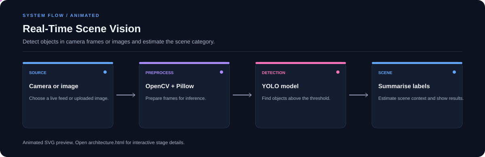

# Real-Time Scene Vision

**Detect objects in camera frames or images and estimate the scene category.**

[](https://github.com/chyk2468/Real-Time-Scene-Detector)

## 1. Project Title & Tagline

Detect objects in camera frames or images and estimate the scene category.

## 2. Problem Statement

A raw camera feed can be difficult to interpret quickly. This project applies object detection and uses detected labels to estimate the scene context.

## 3. Project Preview

Add a screenshot or short GIF of the live interface with a representative input and result.

[Open interactive architecture](architecture.html)

## 4. Overview

The app takes user input, runs the configured processing pipeline, and presents the result in the interface. The workflow below shows the major stages.

## 5. Key Features

- Live webcam mode.
- Upload and analyse a still image.
- Adjust the detection confidence threshold.
- Display object detections and a scene estimate.

## 6. Architecture / Workflow



Open the [interactive architecture explorer](architecture.html) to select a stage and inspect its role.

## 7. Tech Stack

Python, Streamlit, YOLOv8, PyTorch or ONNX, OpenCV, Pillow

## 8. Installation & Setup

```bash
git clone https://github.com/chyk2468/Real-Time-Scene-Detector.git
cd Real-Time-Scene-Detector
python -m venv .venv
pip install -r requirements.txt
```

## 9. Usage

Run `streamlit run app.py`, select webcam or upload mode, and inspect the detected objects and scene estimate. Check `model.py` for the configured model backend and expected weight path.

## 10. Project Structure

- `app.py`: Streamlit interface
- `model.py`: model loading and inference
- `model.pt` and `model.onnx`: model files, if present
- `requirements.txt`: dependencies

## 11. Results & Demo

Add sample screenshots and report precision/recall or another suitable metric on labelled test images. Scene estimates based on object labels should be treated as heuristic.

## 12. Future Enhancements

- Add a labelled scene-evaluation dataset.
- Improve performance on small and occluded objects.
- Show inference latency and model backend.
- Add tests for missing models and camera failures.

## 13. License

Check model-weight, dataset, and source-code licences before redistribution.
