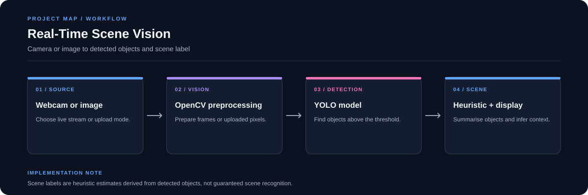

# Real-Time Scene Vision

A Streamlit computer-vision app that detects objects in webcam frames or uploaded images and estimates a scene category from the objects detected.

**Stack:** Python, Streamlit, YOLOv8, PyTorch/ONNX, OpenCV, Pillow



## Features

- Live webcam stream mode
- Upload and snapshot image analysis
- Adjustable object confidence threshold
- Object counts and scene estimate
- Dark interface for live monitoring

## Workflow

1. Select a webcam or image input.
2. Prepare frames with OpenCV/Pillow.
3. Run the detector and filter detections by confidence.
4. Use detected labels to estimate a scene and display object statistics.

## Run locally

```bash
git clone https://github.com/chyk2468/Real-Time-Scene-Detector.git
cd Real-Time-Scene-Detector
python -m venv .venv
```

Activate the environment and install dependencies:

```bash
pip install -r requirements.txt
streamlit run app.py
```

The repository includes model files `model.pt` and `model.onnx`. Check `model.py` for the selected backend and expected model path.

## Limitations

Object detection can miss small, occluded, or out-of-distribution items. A scene estimate based on detected objects can also be wrong when the objects are ambiguous. Treat the result as a visual aid, not as a safety-critical decision.
